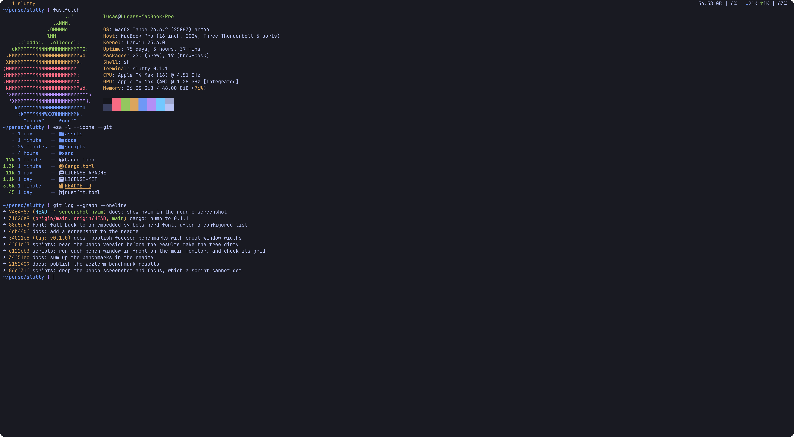

# slutty

A fast, native macOS terminal emulator and multiplexer, built on [libghostty-vt](https://lib.ghostty.org/vt/).



- **Native.** AppKit window, Metal drawing, CoreText shaping, system input methods.
- **Idle when idle.** Draws only what changed. No polling, no timers while nothing moves.
- **A multiplexer built in.** Windows, tabs, splits, zoom, copy mode, search, quick select.
- **Declarative config.** One TOML file, reloaded on save. No scripting.

slutty replaces my WezTerm setup: its feature list is that config, not WezTerm itself.

## Install

Needs macOS 13 or later.

### The app

1. Download `slutty-<version>-arm64.zip` from the [releases](https://github.com/ae2rs/slutty/releases) (Apple silicon).
2. Unzip it and move `slutty.app` to `/Applications`.
3. The app is signed ad hoc, not notarized. Clear the quarantine flag once:
   ```sh
   xattr -dr com.apple.quarantine /Applications/slutty.app
   ```

### From source

Needs Rust 1.96 and [Zig](https://ziglang.org) 0.17 on `PATH`: the build compiles libghostty-vt.

```sh
cargo install --locked --git https://github.com/ae2rs/slutty --tag v0.1.1
```

- A bare binary has no desktop notifications: macOS only lets an app bundle post them.
- From a checkout, `scripts/bundle-app.sh --install` builds `slutty.app` into `~/Applications`.
- crates.io comes once the libghostty-vt 1.0 bindings are published there.

## Usage

- `slutty` opens a window with your login shell, or shows the windows already running.
- `slutty -- <command> [<arg>...]` opens a new window running the command.

### Sessions

Panes run in a server process, `slutty server`, which the app starts by itself. Quitting the app, or a crash, only detaches: launch it again and every window comes back. The server stops when its last window closes.

- Socket: `~/Library/Application Support/slutty/mux.sock`. `--socket PATH` or `$SLUTTY_SOCKET` picks another, for a separate set of windows.
- Log: `~/Library/Logs/slutty/server.log`.
- Each pane gets `SLUTTY_PANE` (its id) and `SLUTTY_SOCKET`.

### Keys

The leader is `ctrl+s`. A few defaults:

| Keys | Action |
| --- | --- |
| `cmd+t`, `leader t` | New tab |
| `cmd+1`…`cmd+9` | Go to a tab |
| `leader v`, `leader -` | Split right, split down |
| `cmd+hjkl`, `leader hjkl` | Focus a pane |
| `leader r` | Resize panes with `hjkl` until `escape` |
| `cmd+z` | Zoom the pane |
| `cmd+f` | Search; `ctrl+r` switches to a regex |
| `leader c` | Copy mode, with vim keys |
| `leader space` | Quick select |
| `cmd+o` | Open a URL on screen |

The full list is in [`src/keys/defaults.toml`](src/keys/defaults.toml).

## Config

slutty reads `~/.config/slutty/slutty.toml` and reloads it on save. Every key is optional.

```toml
[font]
family = "JetBrains Mono"
size = 16

[tab_bar]
status = ["ram", "cpu", "net", "disk"]

[keys]
leader = "ctrl+s"

[keys.bind]
"cmd+d" = "split-right"
```

- A broken file keeps the last good config and shows the error in a banner.
- Every setting is in [docs/design.md](docs/design.md#config).

## Performance

Against WezTerm on an M4 Max, both as shipped and both with my config ([details](docs/benchmarks.md)):

- **Throughput:** 1.2–5.2× faster on every vtebench test.
- **Idle:** as shipped, no CPU and no wake-ups at a still screen. With tab bar stats on, about half WezTerm's CPU.
- **Memory:** as shipped, 159 MB at launch against 289 MB. With 100 000 lines of scrollback the footprints are close, but slutty's resident size is higher.

## Design

[docs/design.md](docs/design.md) covers the layers, threads, rendering and the roadmap.

## License

- slutty: [MIT](LICENSE-MIT) or [Apache-2.0](LICENSE-APACHE), at your option.
- The bundled JetBrains Mono: [SIL Open Font License](assets/fonts/jetbrains-mono/OFL.txt).
- The bundled Symbols Nerd Font: [MIT](assets/fonts/symbols-nerd-font/LICENSE); its icon sets keep their own licenses, [listed here](assets/fonts/symbols-nerd-font/README.md).
